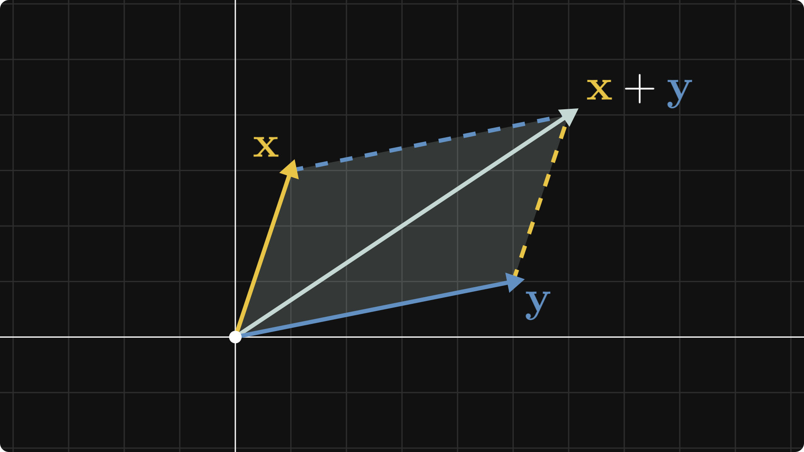

# Publishing a Technical Memo from Markdown

This example walks through everything md2wb does to a Markdown article before you paste it into Substack or X Articles: math, tables, images, code snippets and a drafting directive.

```latex-preamble
\usepackage{xcolor}
\definecolor{maizeCrayola}{HTML}{E8C547}
\definecolor{blueGray}{HTML}{6290C3}
```



## Inline Math That Stays Readable

Inline expressions such as $\alpha + \beta = \gamma$ and $E = mc^2$ become Unicode text, so they stay selectable and searchable in editors that cannot render TeX.

The golden ratio still reads naturally in prose: $\phi = \frac{1 + \sqrt{5}}{2}$.

## Display Math With Labels and References

Display math is rendered to images, and labeled equations are numbered across the whole article.

$$x = \frac{-b \pm \sqrt{b^2 - 4ac}}{2a} \label{eq:quadratic}$$

Equation \eqref{eq:quadratic} gives both roots of $ax^2 + bx + c = 0$.

Colors defined in the preamble work too:

$$
P({\color{maizeCrayola} A} \mid {\color{blueGray} B}) =
\frac{P({\color{blueGray} B} \mid {\color{maizeCrayola} A}) P({\color{maizeCrayola} A})}
{P({\color{blueGray} B})}
$$

So do `\[...\]` and bare LaTeX environments:

\begin{align}
\nabla \cdot \mathbf{E} &= \frac{\rho}{\varepsilon_0} \\
\nabla \cdot \mathbf{B} &= 0
\end{align}

## Tables Become Images

Neither editor accepts pasted tables, so they are drawn as images.

| Target | Images | Good for |
| --- | :---: | --- |
| `substack` | embedded | long-form essays |
| `x` | embedded, plus per-image copy buttons | short technical posts |

## Code Stays Copyable

Code blocks stay as code snippets, so readers can select and copy them:

```python
def fibonacci(n):
    """Yield the first n Fibonacci numbers."""
    a, b = 0, 1
    for _ in range(n):
        yield a
        a, b = b, a + b
```

```bash
npx md2wb article.md --target x --open
```

Use `hide-cell` for drafting aids that do not belong in the published article:

<!-- md2wb: hide-cell -->
```python
print("This block never reaches the output.")
```
